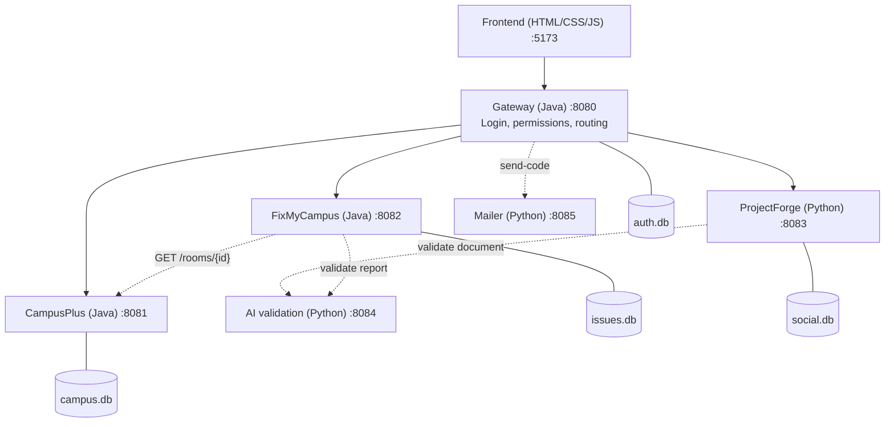

# SDU Bağdar

**A smart campus platform for SDU University.** Students and teachers find free rooms, book office hours, report broken facilities, and discover clubs and initiatives, all from one web app.

Built for CSS 217 (Assignment 2) as a microservice system with **no application frameworks**: Java (JDK `HttpServer`) and Python (standard library), SQLite storage, and a plain HTML/CSS/JavaScript frontend.

| Module | What it does | Stack | Port |
|---|---|---|---|
| **Gateway** | Login, roles, token issuing, API routing, health | Java | 8080 |
| **CampusPlus** | Free rooms, teacher directory, office hours and booking | Java | 8081 |
| **FixMyCampus** | Facility problem reports, review queue, notifications | Java | 8082 |
| **ProjectForge** | Initiatives, clubs, surveys, recommendations, profile | Python | 8083 |
| **AI validation** | Checks club documents and report text (placeholder rules, pluggable) | Python | 8084 |
| **Mailer** | Sends one-time login codes by SMTP | Python | 8085 |
| **Frontend** | Single-page web UI | HTML/CSS/JS | 5173 |

---

## Table of contents
1. [Features](#features)
2. [Architecture](#architecture)
3. [Design patterns](#design-patterns)
4. [Getting started](#getting-started)
5. [Configuration](#configuration)
6. [Using the app](#using-the-app)
7. [API overview](#api-overview)
8. [Testing](#testing)
9. [Project structure](#project-structure)
10. [Security notes](#security-notes)
11. [Troubleshooting](#troubleshooting)
12. [Documentation](#documentation)

---

## Features

**Roles:** `STUDENT` and `TEACHER`. Teacher accounts need an invite code, so nobody can grant themselves the role.

- **CampusPlus**
  - Free rooms right now, from the real SDU layout (blocks D to I, 90 classrooms plus 11 "barrel" halls), filtered by block, floor, kind, capacity or text.
  - Teacher directory and office hours. Overlapping slots are rejected with `409`.
  - Booking by hand, or automatically with a scheduling strategy chosen per request.
- **FixMyCampus**
  - Report a problem in a room: category, description, room code. The room is verified against CampusPlus.
  - Duplicate detection links a new report to an open one for the same room and category.
  - Teachers review reports (`OPEN`, `IN_PROGRESS`, `RESOLVED`). Reporters get notifications.
- **ProjectForge**
  - Initiatives (Project, Event, Party, Research): create, search, follow and unfollow.
  - Recommendations with a runtime-selectable strategy: popularity, recent activity or category.
  - Clubs: register (document checked by the AI validation service), join or leave, deadlines, event pages.
  - Surveys (short answer, choice, checkbox, file upload) with owner-only results.
  - Profile: contacts, photo, notification switches.
- **Platform:** bearer-token auth shared by all services, one JSON error shape, request logging, timeouts on every service call, and `503` instead of a hang when a service is down.

## Architecture



Rules every service follows:

- **Layers:** presentation, then application, then domain. Infrastructure implements the ports. `*Main` / `main.py` is the composition root.
- **Database per service.** No cross-service SQL. Remote entities are referenced by id and checked over HTTP.
- **Identity:** the gateway issues an HS256 token. Every service re-verifies signature and expiry and takes `id` and `role` from the token, never from the request body.
- **Errors:** one JSON shape `{message, code}`. Unreachable services give `503`.

More detail, including deviations and assumptions: [docs/architecture.md](docs/architecture.md).

## Design patterns

| Pattern | Service | Interface | Implementations |
|---|---|---|---|
| **Strategy** | CampusPlus | `SchedulingStrategy` | `FirstAvailableStrategy`, `EarliestDeadlineStrategy`, `PreferredTimeStrategy`, selected by `StrategyRegistry` |
| **Adapter** | CampusPlus | `TimetableProvider` | `LegacyTimetableAdapter` wraps the unmodified `LegacyTimetableSystem` |
| **Decorator** | FixMyCampus | `ReportProcessor` | `BaseReportProcessor` wrapped by `ValidationAuditDecorator`, `DuplicateAlertDecorator`, `NotificationDecorator`, composed by `ReportPipelineFactory` |
| Strategy (extra) | ProjectForge | `RecommendationStrategy` | `PopularityStrategy`, `RecentActivityStrategy`, `CategoryBasedStrategy` |

Each is covered by unit tests, see [TEST_REPORT.md](TEST_REPORT.md).

---

## Getting started

### Prerequisites

| Tool | Version | Check |
|---|---|---|
| JDK | 17 or newer (tested on 25) | `javac -version` |
| Python | 3.11 or newer (tested on 3.14) | `python3 --version` |
| `curl`, `openssl` | any | used by the start script |

macOS and Linux are supported. On Windows use WSL. There are **no packages to install**: the three SQLite/SLF4J jars are already in [lib/](lib/), and Python uses only the standard library.

### Run

```bash
git clone <repository-url> && cd <repository-folder>
scripts/start-all.sh
```

The script:

1. creates `.env` from `.env.example` and generates a random `CAMPUSOS_SECRET` (first run only),
2. compiles the Java modules into `build/`,
3. starts all six services and the frontend,
4. waits until every `/health` endpoint answers.

Then open **http://localhost:5173**.

```bash
curl http://localhost:8080/api/v1/health
# {"gateway":"ok","CampusPlus":"ok","FixMyCampus":"ok","ProjectForge":"ok"}
```

Databases are created on first start in `data/` and seeded with sample data. Logs are in `build/logs/<service>.log`. Stop everything with:

```bash
scripts/stop-all.sh
```

### Demo accounts

Created when `CAMPUSOS_SEED_DEMO=true` (the default in `.env.example`):

| Role | Email | Password |
|---|---|---|
| Student | `student@sdu.edu.kz` | `student123` |
| Teacher | `teacher@sdu.edu.kz` | `teacher123` |

Change both passwords in `.env` before exposing the app to anyone.

### Login codes

New sign-ups use an `@sdu.edu.kz` address and a 6-digit code. Choose one delivery mode in `.env`:

- **Real email:** `MAIL_DELIVERY=mailer` plus the `SMTP_*` settings (use an app password).
- **Local development:** `MAIL_DELIVERY=console`, then read the code with
  `grep "\[auth\]" build/logs/gateway.log | tail -1`
- **Skip codes:** `SDU_BAGDAR_SKIP_VERIFICATION=true` (development only).

### Frontend-only mock mode

To try the UI without any backend, set `window.CAMPUSOS_CONFIG = { useMock: true }` before `js/app.js` in [frontend/index.html](frontend/index.html). Mock mode is for demos only; it never touches real data.

---

## Configuration

All settings come from environment variables, loaded from `.env` by the start script. `.env` is git-ignored. See [.env.example](.env.example) for the full list.

| Variable | Default | Purpose |
|---|---|---|
| `CAMPUSOS_SECRET` | generated | Signs and verifies tokens, and authenticates internal calls. **Keep private.** |
| `CAMPUSOS_TOKEN_TTL_SECONDS` | `28800` | Token lifetime (8 h) |
| `CAMPUSOS_DATA_DIR` | `data` | Where the SQLite files live |
| `CAMPUSOS_ALLOWED_ORIGIN` | `http://localhost:5173` | CORS origin accepted by the API |
| `*_PORT` | 8080 to 8085 | Service ports (`FRONTEND_PORT` defaults to 5173) |
| `TEACHER_INVITE_CODE` | `sdu-teacher` | Needed to register as a teacher |
| `SDU_BAGDAR_SKIP_TEACHER_INVITE` | `true` | Set `false` to enforce the invite code |
| `SDU_BAGDAR_SKIP_VERIFICATION` | `false` | Set `true` to skip email codes |
| `MAIL_DELIVERY` | `mailer` | `mailer` (SMTP) or `console` |
| `SMTP_HOST`, `SMTP_PORT`, `SMTP_SECURITY`, `SMTP_USER`, `SMTP_PASSWORD`, `SMTP_FROM` | empty | Mail server for the Mailer service |
| `FIXMYCAMPUS_PIPELINE` | `validation,duplicate,notification` | Decorator chain, outermost first |
| `AI_PROVIDER_URL` | empty | Optional external AI. Empty means the local rules are used. |
| `CAMPUSOS_SEED_DEMO` | `true` | Create the demo accounts |

---

## Using the app

A short walkthrough that exercises every service:

1. **Sign in** as the student. The dashboard shows the next steps.
2. **Rooms:** filter free rooms by block or capacity (CampusPlus, timetable adapter).
3. **Teachers:** open the directory and book an office hour. Try the *auto* mode with the strategies *first*, *deadline* and *preferred time*.
4. **Issues:** report a broken lamp in a room such as `D101`. Submit the same problem again to see the duplicate warning.
5. **Initiatives:** create one, follow it, and switch the recommendation strategy.
6. **Clubs:** join a club and see its deadlines.
7. Sign in as the teacher: create office hours and move the issue to `IN_PROGRESS`, then `RESOLVED`. The student sees the notification.

## API overview

All routes are under `/api/v1` on the gateway (`http://localhost:8080`). Send `Authorization: Bearer <token>` except for `/auth/*` and `/health`.

```bash
TOKEN=$(curl -s -X POST localhost:8080/api/v1/auth/login \
  -H 'Content-Type: application/json' \
  -d '{"email":"student@sdu.edu.kz","password":"student123"}' | python3 -c 'import sys,json;print(json.load(sys.stdin)["token"])')

curl -s -H "Authorization: Bearer $TOKEN" 'localhost:8080/api/v1/rooms?building=D&minCapacity=30'
```

| Area | Endpoints |
|---|---|
| Auth | `POST /auth/register`, `POST /auth/login`, `POST /auth/request-code`, `GET /auth/me` |
| CampusPlus | `GET /buildings`, `GET /rooms`, `GET /rooms/{id}`, `GET /teachers`, `PUT /teachers/me`, `GET/POST /office-hours`, `GET /office-hours/strategies`, `POST /office-hours/book` |
| FixMyCampus | `GET /issue-categories`, `GET/POST /issues`, `POST /issues/{id}/status`, `GET /issues/notifications` |
| ProjectForge | `GET/POST /initiatives`, `POST /initiatives/follow`, `GET /recommendations?strategy=`, `GET/POST /clubs`, `POST /clubs/toggle`, `/surveys/*`, `GET/PUT /profile` |

Status codes: `400` malformed, `401` not signed in, `403` wrong role, `404` unknown, `409` conflict, `422` invalid input, `503` a dependent service is unavailable. Per-service endpoint tables and request shapes are in each `services/*/explanation.md`.

---

## Testing

| Suite | Command | What it covers |
|---|---|---|
| Pattern unit tests (Java, no dependencies) | `tests/run-java-tests.sh` | Strategy, Adapter and Decorator |
| End-to-end through the gateway | `python3 tests/e2e_test.py` | Auth, rooms, office hours, issues, initiatives, clubs. **The stack must be running.** |
| ProjectForge unit tests | `python3 -m unittest discover -s services/project-forge-python -t services/project-forge-python` | Recommendation strategies |
| AI validation unit tests | `python3 -m unittest discover -s services/ai-validation-python -t services/ai-validation-python` | Validation rules |
| Mailer unit tests | `python3 -m unittest discover -s services/mailer-python -t services/mailer-python` | Recipient rules, SMTP sender |

Run everything:

```bash
scripts/start-all.sh
tests/run-java-tests.sh
python3 tests/e2e_test.py
for s in project-forge-python ai-validation-python mailer-python; do
  python3 -m unittest discover -s services/$s -t services/$s
done
scripts/stop-all.sh
```

Results, with the exact output of the last run, are in **[TEST_REPORT.md](TEST_REPORT.md)**.

---

## Project structure

```
frontend/                  Static single-page app (views/, api.js, session.js, mock.js)
services/
  common-java/             Shared plumbing: HTTP routing, JSON, tokens, SQLite helper
  gateway-java/            Auth, access policy, proxy
  campus-plus-java/        Rooms, office hours   (Strategy, Adapter)
  fix-my-campus-java/      Issue reports         (Decorator)
  project-forge-python/    Initiatives, clubs, surveys, profile (Strategy)
  ai-validation-python/    Placeholder validators + optional external provider
  mailer-python/           SMTP code delivery
tests/                     Java pattern tests, end-to-end test
scripts/                   build.sh, start-all.sh, stop-all.sh
lib/                       sqlite-jdbc, slf4j jars
data/                      SQLite files (created at runtime, git-ignored)
build/                     Classes, logs, pids (git-ignored)
docs/                      Architecture notes and the report source
```

Each service folder has an `explanation.md` and (where it owns a database) `docs/db-uml.md`.

## Security notes

- Passwords: PBKDF2-HMAC-SHA256, 120,000 iterations, random salt.
- Verification codes are stored hashed, expire after 10 minutes, and are rate-limited to one request per minute per email. Codes are never written to logs in mailer mode.
- Roles are enforced twice: at the gateway and again inside each service.
- The Mailer listens on `127.0.0.1` and requires the internal key.
- `.env`, databases and logs are git-ignored. Never commit secrets.

**Before a real deployment:** set a strong `CAMPUSOS_SECRET`, change the demo passwords or set `CAMPUSOS_SEED_DEMO=false`, set `SDU_BAGDAR_SKIP_TEACHER_INVITE=false` and `SDU_BAGDAR_SKIP_VERIFICATION=false`, serve over HTTPS behind a reverse proxy, and set `CAMPUSOS_ALLOWED_ORIGIN` to your real domain. The timetable, grades and notification feed are simulated demo data.

## Troubleshooting

| Symptom | Fix |
|---|---|
| `Address already in use` | Another process holds a port. Run `scripts/stop-all.sh`, or change the port in `.env`. |
| `javac: command not found` | Install JDK 17+ and make sure it is on `PATH`. |
| Health shows `down` for a service | Read `build/logs/<service>.log`. |
| No login code arrives | Check the `SMTP_*` settings, or use `MAIL_DELIVERY=console` and read the gateway log. |
| End-to-end test cannot connect | Start the stack first with `scripts/start-all.sh`. |
| Want a clean database | `scripts/stop-all.sh`, delete `data/*.db`, start again. |

## Documentation

- [TEST_REPORT.md](TEST_REPORT.md): test plan, cases and results
- [docs/architecture.md](docs/architecture.md): architecture, patterns, decisions
- [SDU_Bagdar_Report.pdf](SDU_Bagdar_Report.pdf): full project report (requirements, UML, database design, tests, user guide). Source: `docs/report/report.html`
- [plan.md](plan.md): development plan
- Per-service notes: `services/*/explanation.md`
