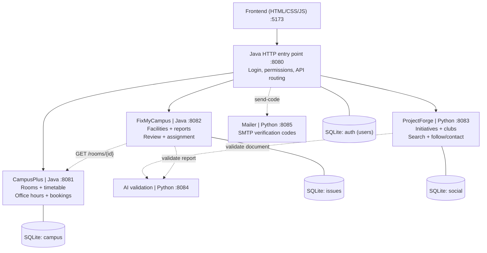

# SDU Bağdar architecture



| Folder | Service | Language | Explanation |
|---|---|---|---|
| `services/gateway-java` | entry point | Java | [explanation](../services/gateway-java/explanation.md) |
| `services/campus-plus-java` | CampusPlus | Java | [explanation](../services/campus-plus-java/explanation.md) |
| `services/fix-my-campus-java` | FixMyCampus | Java | [explanation](../services/fix-my-campus-java/explanation.md) |
| `services/project-forge-python` | ProjectForge | Python | [explanation](../services/project-forge-python/explanation.md) |
| `services/ai-validation-python` | AI validation (placeholder) | Python | [explanation](../services/ai-validation-python/explanation.md) |
| `services/mailer-python` | Mailer (SMTP codes) | Python | [explanation](../services/mailer-python/explanation.md) |
| `services/common-java` | shared Java plumbing | Java | [explanation](../services/common-java/explanation.md) |

## Required design patterns
| Pattern | Service | Where |
|---|---|---|
| Strategy | CampusPlus | `SchedulingStrategy`: `FirstAvailableStrategy`, `EarliestDeadlineStrategy`, `PreferredTimeStrategy`, selected per request through `StrategyRegistry` |
| Adapter | CampusPlus | `TimetableProvider` <- `LegacyTimetableAdapter` -> `LegacyTimetableSystem` (unmodified, incompatible format) |
| Decorator | FixMyCampus | `ReportProcessor`: `BaseReportProcessor` wrapped by `ValidationAuditDecorator`, `DuplicateAlertDecorator`, `NotificationDecorator`; `ReportPipelineFactory` composes them |

## Rules every service follows
- **Layers:** presentation -> application -> domain; infrastructure implements application/domain ports; `*Main` / `main.py` is the composition root.
- **Database per service.** No cross-service SQL or foreign keys. Remote entities are referenced by id and checked over HTTP (FixMyCampus asks CampusPlus whether a room exists).
- **Identity:** the gateway issues an HS256 token; every service re-verifies signature and expiry and reads `id` and `role` from it. Sign-in uses an SDU email; verification is temporarily disabled by `SDU_BAGDAR_SKIP_VERIFICATION=true` for development. The secret comes from `CAMPUSOS_SECRET` in `.env`, never from code.
- **Errors:** one JSON shape `{message, code}`; unreachable services give 503, never a hang (timeouts on every outgoing call).
- **Logging:** every request is logged to the console as `[service] METHOD path -> status (ms)`.

## Deviations and assumptions
- The diagram shows no database for the gateway; it keeps a small `users` table (`auth.db`) because login needs one.
- Teacher accounts require an invite code (`TEACHER_INVITE_CODE`) so the role cannot be self-assigned.
- "Barrel" rooms (`H01-H03, D117, D218, D116, D217, D113, D214, E117, E221`) are modelled as a room kind with larger capacity; confirm what they are in reality.
- The timetable, grades and the notification feed are simulated demo data.
- ProjectForge is Python standard library only (no FastAPI), following AGENTS.md ("no Spring/Django/FastAPI/Flask").

## Run
```bash
scripts/start-all.sh      # builds, starts everything, creates .env with a random secret
python3 tests/e2e_test.py # 14 end-to-end tests through the gateway
python3 -m unittest discover -s services/project-forge-python -t services/project-forge-python
scripts/stop-all.sh
```
Open http://localhost:5173. Demo accounts come from `.env` (`student@sdu.edu.kz`, `teacher@sdu.edu.kz`). The current development delivery adapter prints verification codes to the gateway log; replace it with the university email provider for production. Set `CAMPUSOS_SEED_DEMO=false` to skip demo accounts.
