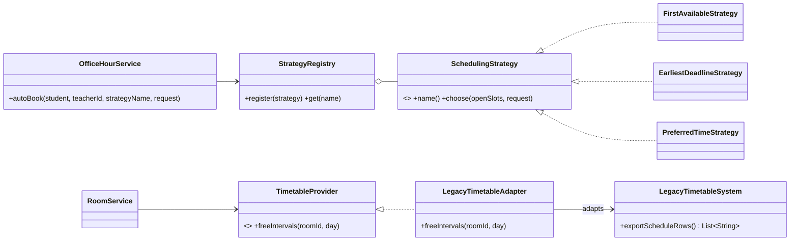

# CampusPlus (Java) :8081

**Owns:** rooms, timetable data, teacher offices, office-hour slots and student bookings.
**Does not own:** repair reports (FixMyCampus), initiatives (ProjectForge).

## Campus model
Only the real SDU layout exists: blocks **D, E, F, G, H, I** with rooms `101-105`, `201-205`, `301-305` per block (90 classrooms) plus 11 "barrel" halls: `H01 H02 H03 D117 D218 D116 D217 D113 D214 E117 E221`. Block colours: D purple, E brown, F dark blue, G pistachio, H light blue, I dark green.

## Endpoints (`/api/v1`)
| Method + path | Who | Notes |
|---|---|---|
| `GET /buildings` | any user | includes the block colour |
| `GET /rooms` | any user | free rooms now. Filters `building`, `floor`, `kind` (Classroom/Barrel), `minCapacity`, `q`; test overrides `at=HH:mm`, `day=1..7` |
| `GET /rooms/{id}` | any user | used by FixMyCampus to validate a room |
| `GET /teachers` | any user | directory |
| `PUT /teachers/me` | TEACHER | register or update own office |
| `GET/POST /office-hours` | any / TEACHER | POST rejects overlapping slots (409) |
| `POST /office-hours/book` | any user | `{id}` for manual booking, or `{teacherId, strategy, deadline?, preferredTime?}` for automatic |

## Design patterns
### Strategy: office-hour scheduling
`SchedulingStrategy` is the interface. `FirstAvailableStrategy` (first slot in the weekly order), `EarliestDeadlineStrategy` (soonest slot that still happens before the student's deadline) and `PreferredTimeStrategy` (start time closest to the preferred time) implement it. `StrategyRegistry` looks one up by name **per request**. A fourth algorithm needs one new class and one `register(...)` line in `CampusPlusMain`; nothing else changes.

### Adapter: SDU timetable import
`TimetableProvider` is the interface the application uses. `LegacyTimetableSystem` simulates the external system with an incompatible format (pipe-separated text rows, weekday numbers, `HHMM` integers) and is never modified. `LegacyTimetableAdapter` converts those rows into `FreeInterval`s, which `RoomService` uses to decide which rooms are free.

## Layers
`presentation/` (controllers, `CampusPlusMain`) → `application/` (services, ports, `StrategyRegistry`) → `domain/` (entities, `SchedulingStrategy`, `TimetableProvider`) ← `infrastructure/` (SQLite repositories, schema/seed, legacy adapter).

## Data
`data/campus.db`, see [docs/db-uml.md](docs/db-uml.md). Student ids in bookings are plain values from the token; there is no foreign key into another database.

## Known simplification
The timetable is a deterministic simulation, not real SDU data. Outside 08:30-18:00 the "free now" check uses 08:30 so the list is never empty.
