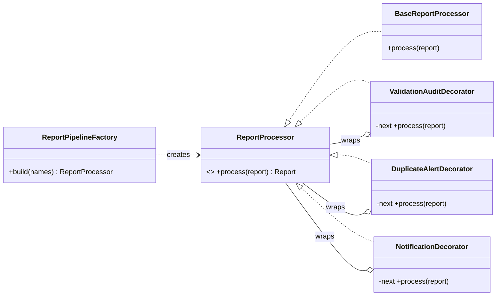

# FixMyCampus (Java) :8082

**Owns:** repair reports, categories, audit trail, notifications to reporters.
**Does not own:** rooms. A report stores only the room code, and the room is validated by calling CampusPlus (`GET /rooms/{id}`) through `CampusPlusRoomDirectory`. If CampusPlus is down the user gets a clear `503`, and FixMyCampus never reads CampusPlus's database.

## Endpoints (`/api/v1`)
| Method + path | Who | Notes |
|---|---|---|
| `GET /issue-categories` | any user | |
| `GET /issues` | any user | own reports; `?scope=all` returns every report for teachers (review queue) |
| `POST /issues` | any user | `{roomId, category, description}` -> 201; `warning` and `duplicateOf` are set if a similar report is open |
| `POST /issues/{id}/status` | TEACHER | `OPEN`, `IN_PROGRESS`, `RESOLVED`; the reviewer becomes the assignee |
| `GET /issues/notifications` | any user | latest messages for the caller |

## Design pattern: Decorator (report processing)
`ReportProcessor` is the component interface. `BaseReportProcessor` saves the report. Three decorators wrap it and can be stacked in any order or combination:

| Decorator | Before the wrapped call | After |
|---|---|---|
| `ValidationAuditDecorator` | validates category and description, audits `REJECTED` and throws 422 | audits `SUBMITTED` |
| `DuplicateAlertDecorator` | finds an open report for the same room and category, links `duplicateOf` | alerts the original reporter |
| `NotificationDecorator` | | tells the reporter the report was received |

`ReportPipelineFactory.build(names)` assembles the chain from `FIXMYCAMPUS_PIPELINE` (default `validation,duplicate,notification`, outermost first). Business validation stays mandatory at the service boundary: `ReportService.submit` checks that the room exists and has a description regardless of the chain.

## Layers
`presentation/` → `application/` (`ReportService`, ports, `processing/` decorators) → `domain/` (`Report`, `ReportStatus`, `ReportProcessor`) ← `infrastructure/` (SQLite repositories, HTTP room directory).

## Data
`data/issues.db`, see [docs/db-uml.md](docs/db-uml.md).
