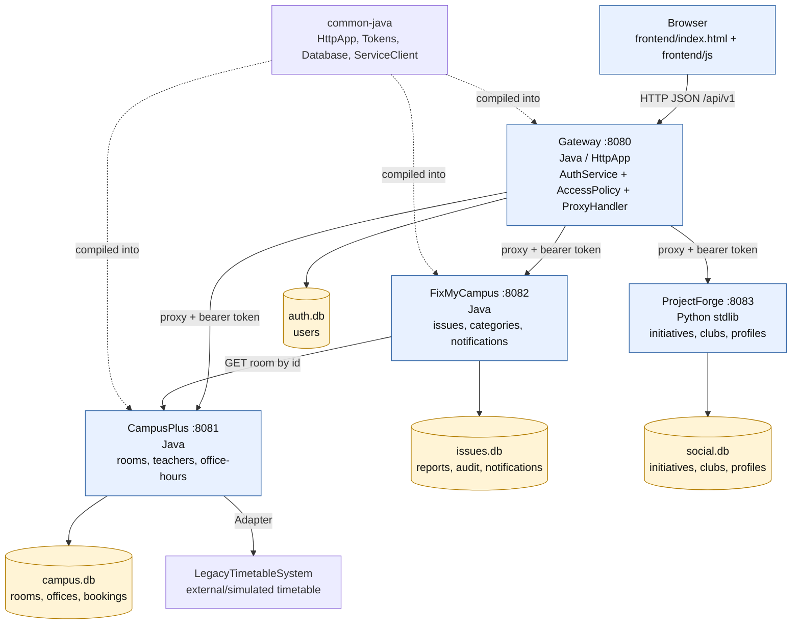

# SDU Bağdar — UML diagram

Диаграмма построена по исходникам в `services/`, `frontend/`, `scripts/` и
`docs/architecture.md`. Mermaid-код можно открыть в GitHub, Mermaid Live или
в любом редакторе Markdown с поддержкой Mermaid.

## Component / deployment view

Основные правила интеграции:

- frontend обращается только к Gateway (`frontend/js/config.js`);
- Gateway выбирает backend по префиксу пути через `ServiceRoutes`;
- каждый сервис самостоятельно проверяет JWT;
- базы данных принадлежат своим сервисам и не разделяются;
- FixMyCampus хранит только `room_id`, а существование комнаты проверяет через HTTP;
- таймауты межсервисных вызовов превращаются в `503`.

## Backend class view

```mermaid
classDiagram
    direction LR

    namespace Common {
        class HttpApp {
            +route(method, pattern, handler)
            +start()
        }
        class Tokens {
            +fromEnv()
            +issue(user)
            +verify(token)
        }
        class Database {
            +query()
            +transaction()
        }
        class ServiceClient {
            +get(path, bearer)
            +post(path, body, bearer)
        }
    }

    namespace Gateway {
        class GatewayMain
        class ProxyHandler {
            +handle(request)
        }
        class ServiceRoutes {
            +ownedPrefixes()
        }
        class AccessPolicy {
            +check(user, method, path)
        }
        class AuthService {
            +register(...)
            +login(email, password)
        }
        class UserRepository
        class PasswordHasher
        class SqliteUserRepository
        class Pbkdf2PasswordHasher
    }

    namespace CampusPlus {
        class RoomController
        class OfficeHourController
        class RoomService
        class OfficeHourService
        class RoomRepository
        class OfficeHourRepository
        class TeacherRepository
        class Room
        class Building
        class OfficeHour
        class SchedulingRequest
        class SchedulingStrategy {
            <<interface>>
            +name()
            +choose(openSlots, request)
        }
        class FirstAvailableStrategy
        class EarliestDeadlineStrategy
        class PreferredTimeStrategy
        class StrategyRegistry
        class TimetableProvider {
            <<interface>>
            +freeIntervals(roomId, day)
        }
        class LegacyTimetableAdapter
        class LegacyTimetableSystem
        class SqliteRoomRepository
        class SqliteOfficeHourRepository
        class SqliteTeacherRepository
    }

    namespace FixMyCampus {
        class ReportController
        class ReportService
        class ReportRepository
        class ReportProcessor {
            <<interface>>
            +process(report)
        }
        class BaseReportProcessor
        class ValidationAuditDecorator
        class DuplicateAlertDecorator
        class NotificationDecorator
        class ReportPipelineFactory
        class RoomDirectory {
            <<interface>>
            +exists(roomId, bearer)
        }
        class CampusPlusRoomDirectory
        class SqliteReportRepository
    }

    namespace ProjectForge {
        class Routes
        class InitiativeService
        class ClubService
        class ProfileService
        class InitiativeRepository
        class ClubRepository
        class ProfileRepository
        class Initiative
        class Club
        class AuthUser
        class RecommendationStrategy {
            <<abstract>>
            +rank(initiatives, followedCategories)
        }
        class PopularityStrategy
        class RecentActivityStrategy
        class CategoryBasedStrategy
        class StrategyRegistry
        class Database
    }

    GatewayMain --> HttpApp
    GatewayMain --> AuthService
    GatewayMain --> ProxyHandler
    GatewayMain --> ServiceRoutes
    ProxyHandler --> ServiceClient
    ProxyHandler --> AccessPolicy
    AuthService --> UserRepository
    AuthService --> PasswordHasher
    SqliteUserRepository ..|> UserRepository
    Pbkdf2PasswordHasher ..|> PasswordHasher
    SqliteUserRepository --> Database

    CampusPlusMain ..> RoomController
    CampusPlusMain ..> OfficeHourController
    RoomController --> RoomService
    OfficeHourController --> OfficeHourService
    RoomService --> RoomRepository
    RoomService --> TimetableProvider
    OfficeHourService --> OfficeHourRepository
    OfficeHourService --> TeacherRepository
    OfficeHourService --> StrategyRegistry
    StrategyRegistry o-- SchedulingStrategy
    SchedulingStrategy <|.. FirstAvailableStrategy
    SchedulingStrategy <|.. EarliestDeadlineStrategy
    SchedulingStrategy <|.. PreferredTimeStrategy
    LegacyTimetableAdapter ..|> TimetableProvider
    LegacyTimetableAdapter --> LegacyTimetableSystem
    SqliteRoomRepository ..|> RoomRepository
    SqliteOfficeHourRepository ..|> OfficeHourRepository
    SqliteTeacherRepository ..|> TeacherRepository

    ReportController --> ReportService
    ReportService --> ReportProcessor
    ReportService --> ReportRepository
    ReportService --> RoomDirectory
    BaseReportProcessor ..|> ReportProcessor
    ValidationAuditDecorator ..|> ReportProcessor
    DuplicateAlertDecorator ..|> ReportProcessor
    NotificationDecorator ..|> ReportProcessor
    ValidationAuditDecorator o-- ReportProcessor
    DuplicateAlertDecorator o-- ReportProcessor
    NotificationDecorator o-- ReportProcessor
    ReportPipelineFactory ..> ReportProcessor
    CampusPlusRoomDirectory ..|> RoomDirectory
    CampusPlusRoomDirectory --> ServiceClient
    SqliteReportRepository ..|> ReportRepository

    Routes --> InitiativeService
    Routes --> ClubService
    Routes --> ProfileService
    InitiativeService --> InitiativeRepository
    InitiativeService --> ProjectForge.StrategyRegistry
    ClubService --> ClubRepository
    ProfileService --> ProfileRepository
    ProfileService --> ClubRepository
    RecommendationStrategy <|.. PopularityStrategy
    RecommendationStrategy <|.. RecentActivityStrategy
    RecommendationStrategy <|.. CategoryBasedStrategy
    ProjectForge.StrategyRegistry o-- RecommendationStrategy
    InitiativeRepository --> ProjectForge.Database
    ClubRepository --> ProjectForge.Database
    ProfileRepository --> ProjectForge.Database
```

## Verification notes

Проверено по исходникам:

1. Все Java composition roots действительно создают контроллеры, application
   services, SQLite repositories и HTTP routes.
2. Реализованы и подключены три стратегии CampusPlus, адаптер timetable и три
   декоратора FixMyCampus.
3. ProjectForge действительно содержит дополнительный Strategy pattern для
   рекомендаций (`domain/recommendation.py`).
4. `CampusPlusRoomDirectory` использует `ServiceClient`, поэтому связь
   FixMyCampus → CampusPlus является HTTP-связью, а не связью с SQLite.
5. Mermaid-синтаксис диаграммы проверен статически: все имена связей относятся
   к классам, интерфейсы помечены `<<interface>>`, реализации используют
   `..|>`, композиции — `o--`.
